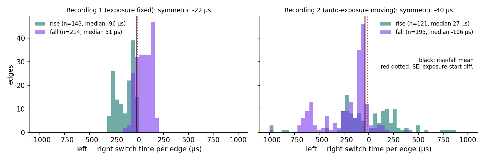
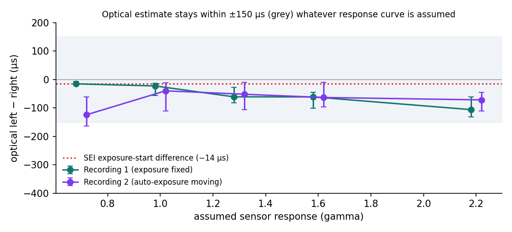
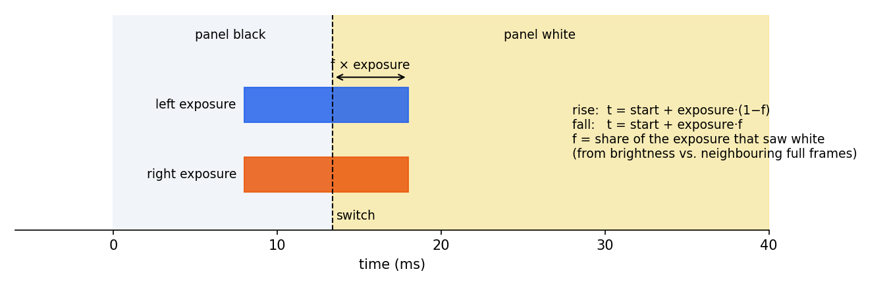
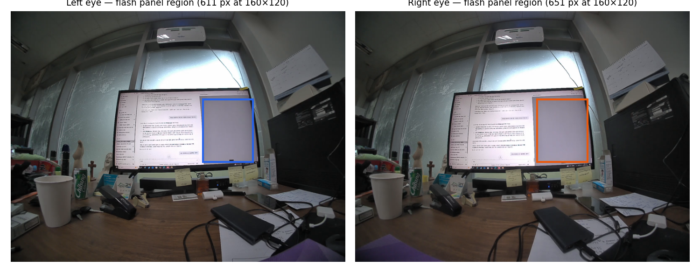
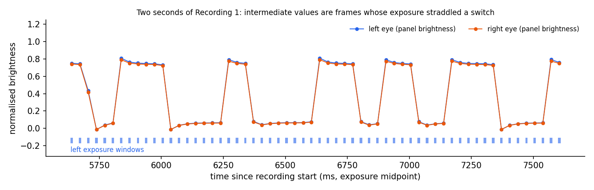

<!-- ODL_QUALITY_V2 -->

# Origin Data Lab · Technical Field Note #22

**ODL Stereo Sync Checked With External Flash**

[](https://github.com/origin-data-lab/stereo-sync-external-flash-verification) [](https://huggingface.co/datasets/origin-data-lab/stereo-sync-external-flash-verification) [](https://www.kaggle.com/datasets/origindatalab/odl-stereo-sync-external-flash) [](https://origindatalab.io/technical-field-notes/stereo-sync-external-flash-verification.html)

[English technical note](https://origindatalab.io/technical-field-notes/stereo-sync-external-flash-verification.html) | [Korean technical note](https://origindatalab.io/ko/technical-field-notes/stereo-sync-external-flash-verification.html)

---

# ODL Field Note #22 — Stereo left/right synchronisation checked with an external flashing monitor
```bash
pip install numpy scipy matplotlib opencv-python-headless   # ffmpeg must be on PATH
python3 analysis/fn22_flash_sync.py extract <records_dir> <segment> cache/          # per-frame SEI + 160x120 gray, both eyes
python3 analysis/fn22_flash_sync.py analyse cache/ <segment> rec1 out/ 0.7 1.0 1.3 1.6 2.2
python3 analysis/fn22_figs.py out/ <records_dir> figures/ assets/tables/
```
Included: per-recording summary, every switch timed in both eyes (gamma 1), sensitivity to the assumed sensor response curve (gamma 0.7–2.2) and per-row-band results, for two 2-minute flash recordings. Images and raw recordings are not distributed.
Licence: Creative Commons Attribution 4.0 International (CC BY 4.0) for derived data and figures; MIT for code.

<!-- ODL_ENTITY_V1 -->
## About Origin Data Lab

**Origin Data Lab** (origindatalab.io, OriginDataLab Co., Ltd.) is a real-world data collection company based in **Yangyang, Gangwon State, South Korea**. We plan and run egocentric, stereo+IMU and field video capture for physical AI and robotics teams, with documented QA such as the measurements in this dataset. Not affiliated with "Origin Lab" (game data) or "OriginLab" (Origin/OriginPro software).

- **[Request sample data](https://origindatalab.io/contact.html?topic=sample&note=fn22&utm_source=github&utm_medium=referral&utm_campaign=field-notes)**: stereo+IMU or phone+IMU egocentric capture
- **[Custom data collection](https://origindatalab.io/data-services.html?utm_source=github&utm_medium=referral)**: field capture in South Korea and Bangladesh
- **[All technical field notes](https://origindatalab.io/technical-field-notes/?utm_source=github&utm_medium=referral)**

## Visual evidence

Figures are taken from the released technical-note package. Interpret with the original methods and limitations.

### Figure 1



*Per-switch left − right timing (γ = 1). Rises and falls are offset in opposite directions; their mean (black) sits next to the metadata value (red).*

### Figure 2



*Average left − right (95% CI) for each assumed response curve. Grey band: ±150 µs. Red: rig metadata.*

### Figure 3



*A switch inside the exposure window: the fraction f that saw white locates the switch within the window.*

### Figure 4



*Recording 1, both eyes. The outlined panel switches between black and white; everything else in the scene is static.*

### Figure 5



*Panel brightness in both eyes over two seconds of recording 1. The traces overlap; intermediate points are partly exposed frames.*


---

## Explore Origin Data Lab

[](https://github.com/origin-data-lab/stereo-sync-external-flash-verification) [](https://huggingface.co/datasets/origin-data-lab/stereo-sync-external-flash-verification) [](https://www.kaggle.com/datasets/origindatalab/odl-stereo-sync-external-flash) [](https://origindatalab.io/technical-field-notes/stereo-sync-external-flash-verification.html)

[Official Website](https://origindatalab.io/) | [Technical Field Notes](https://origindatalab.io/technical-field-notes/) | [English Note](https://origindatalab.io/technical-field-notes/stereo-sync-external-flash-verification.html) | [Korean Note](https://origindatalab.io/ko/technical-field-notes/stereo-sync-external-flash-verification.html)

[GitHub](https://github.com/origin-data-lab/stereo-sync-external-flash-verification) | [Hugging Face](https://huggingface.co/datasets/origin-data-lab/stereo-sync-external-flash-verification) | [Kaggle Dataset](https://www.kaggle.com/datasets/origindatalab/odl-stereo-sync-external-flash) | [Kaggle Notebook](https://www.kaggle.com/code/origindatalab/odl-stereo-sync-external-flash-notebook)


## Code availability

Device-specific readers and production pipeline code are withheld; see `CODE_AVAILABILITY.md`. Figures and result tables are complete.
